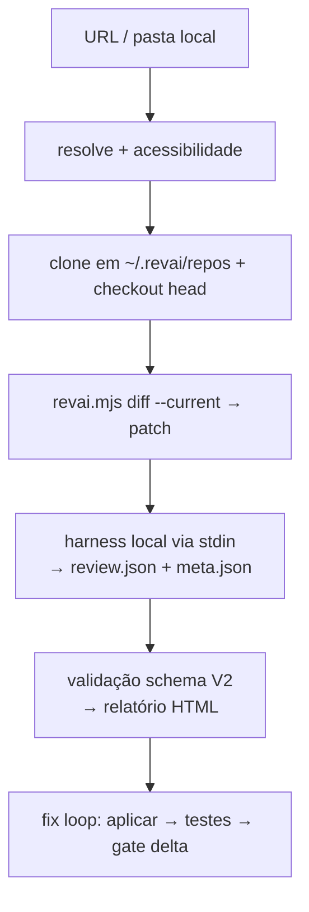

<div align="center">
  

# revai

**Code review com IA, rodando 100% na sua máquina.**

[](#-como-rodar) [](https://nodejs.org) [](#-dados-e-privacidade)

</div>

---

A plataforma é o **host local da skill** [`skill-version/revai`](./skill-version/revai): você aponta um repo remoto (branch, PR, MR, commit) **ou uma pasta local**, e o agente CLI da sua máquina executa a revisão — o mesmo pipeline de 5 passos, Quality Gate e fix loop da skill, agora com orquestração e interface.

## ✨ Destaques

- 👀 **5 passos ao vivo** — resolve → clone → diff → skill → relatório, com log em streaming (SSE)
- ✅ **Quality Gate** — espelho fiel de `computeGate()`: fail só com `critical` aberto
- 🔁 **Fix loop** — aplica a correção, roda os testes e mostra o delta do Gate
- 🤖 **Harness à sua escolha** — `kiro-cli`, `claude`, `codex`, `opencode` ou `copilot`, configurado no onboarding
- 💾 **100% local** — sem telemetria; dados em `~/.revai`, commits só com o seu clique

## 🧭 Como funciona



O pipeline é o da skill (`revai.mjs` + `generate-review.mjs`); a plataforma orquestra e desenha:

1. **Resolver** — `github.com/org/repo/tree/branch`, `pull/482`, `merge-requests/12`, `@sha` ou pasta local.
2. **Clonar e diff** — clone em `~/.revai/repos/<host>/<org>/<repo>` e `diff --current` contra a base (`origin/HEAD` + `merge-base`).
3. **Revisar** — o harness recebe via stdin o escopo do patch, as regras do projeto (`.revai/rules.md` > `CODING_STANDARDS.md`/`CONTRIBUTING.md`) e os caminhos da skill; ele só lê código e escreve em `.revai/` do clone.
4. **Validar** — schema V2 da skill; se falhar, nada é gerado e a UI mostra o erro real.
5. **Relatar e corrigir** — Gate + findings na UI; no fix loop as edições ficam unstaged até você pedir o push (`revai/fix-<slug>`).

| Harness | Invocação padrão |
|---------|------------------|
| Kiro CLI | `kiro-cli exec` |
| Claude Code | `claude -p --allowedTools "Write,Read,Glob,Grep" --disallowedTools Bash` |
| Codex | `codex exec --sandbox workspace-write` |
| OpenCode | `opencode run` |
| Copilot CLI | `copilot -p` (experimental) |

> O prompt vai **sempre via stdin** (evita limite de linha no Windows). Flags próprias: edite `customArgs` em `~/.revai/harnesses.json` (tokens `{exe} {prompt} {model}`).

## 🚀 Como rodar

**Pré-requisitos:** Node ≥ 20.9 (22+ recomendado), Git e pelo menos um harness CLI no PATH.

```bash
npm install

# desenvolvimento — API :8797 + Vite :5173 (proxy)
npm run dev           # http://localhost:5173

# produção local — API + UI na mesma porta
npm run build
npm start             # http://127.0.0.1:8797  (--open abre o navegador)

# qualidade
npm run typecheck     # TypeScript sem emitir
npm test              # vitest
```

> ⚠️ **A UI depende da API.** Se aparecer "Servidor local offline", o `npm start` não está rodando — mantenha o processo vivo.

Variáveis de ambiente:

| Var | Padrão | O que muda |
|-----|--------|------------|
| `REVAI_PORT` | `8797` | Porta da API/UI |
| `REVAI_HOME` | `~/.revai` | Diretório de dados (repos, reviews, settings) |
| `REVAI_SKILL_DIR` | `./skill-version/revai/skills/revai` | Onde estão os scripts da skill |

## 🖥️ Telas

| # | Tela | Rota |
|---|------|------|
| 01 | Onboarding — detecta CLIs e define o runner padrão | `/onboarding` |
| 02 | Nova review — URL ou pasta local, "continuar de onde parou" | `/new` |
| 03 | Configure — escopo, base, regras, harness e estimativa | `/configure` |
| 04 | Running — stepper dos 5 passos com log bruto | `/running` |
| 05 | Relatório — Gate + findings, filtros e Pular/Restaurar | `/report/:id` |
| 06 | Fix loop — fila de correções com teste e delta do Gate | `/fix/:id` |
| 07 | History — todas as reviews com resultado do Gate | `/` |
| 09 | Settings — tema, regras globais, cache e acesso git | `/settings` |
| 10 | States — catálogo dos estados desenhados | `/states` |

> A 08 (`/harnesses`) não existe na v1: o runner é definido no onboarding e aparece nas telas 02/03 só como status.

## ⌨️ Atalhos

| Tecla | Onde | Ação |
|-------|------|------|
| `Ctrl K` / `⌘K` | global | Command palette (ações, reviews recentes, colar URL) |
| `N` · `T` · `Esc` | global | Nova review · alternar tema · fechar palette |
| `Ctrl ↵` | 03 | Iniciar review |
| `J` / `K` | 05 | Finding próximo / anterior |
| `S` / `C` | 05 | Pular/restaurar · copiar prompt |
| `F` | 05 | Mandar o finding para o fix loop |

## 📦 Dados e privacidade

```
~/.revai/
├─ settings.json · harnesses.json
├─ repos/<host>/<org>/<repo>          # clones em cache — limpe em Settings
└─ reviews/<id>/                       # record.json · review.json · meta.json · review.patch · review.html
```

- Nada sai da sua máquina: o diff e as regras circulam só entre o clone sandbox, a skill e o seu harness.
- Nada é escrito até o schema V2 validar — herança direta do `generate-review.mjs`.
- Commits só com o seu clique: fixes ficam unstaged; "criar branch e push" é uma ação explícita.

## 🗂️ Estrutura

```
src/
├─ shared/            contrato: types.ts · gate.ts (computeGate) · urls.ts (parser de origem)
├─ server/            hono + @hono/node-server
│  ├─ pipeline.ts     orquestração do review (SSE)
│  ├─ fixloop.ts      fila de fixes (apply → testes → gate delta)
│  ├─ git.ts          plumbing: clone, checkout, numstat, push, reset
│  └─ harnesses.ts    descoberta, validação e templates de invocação
└─ app/               react 19 + vite (styles.css = porta do prototype)
   ├─ screens/        Onboarding · NewReview · Configure · Running · Report · Fix · History · Settings · States
   └─ ui.tsx          badges, stepper, terminal, code-diff, toasts, gate panel
```

## 🛣️ Roadmap

- [ ] Handshake ACP completo (checklist por item, sessão read-only)
- [ ] Redação de segredos antes do patch sair do clone
- [ ] Edição de templates de harness pela UI (telas 08)
- [ ] Comparação de reviews e multi-reviews agendadas
- [ ] Insights agregados entre repos

---

Feito sobre a skill [`skill-version/revai`](./skill-version/revai) e a narrativa do [`prototype/index.html`](./prototype/index.html). Design **"Hard Hat"**: zinc + amarelo `#facc15`, reservado à ação primária, ao foco e à marca.
