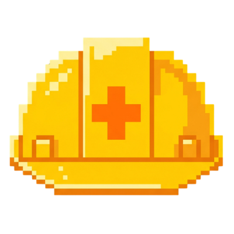

<div align="center">
  

# REVAI PLATFORM

**AI code review, running 100% on your machine using your harness.**

[](#-getting-started) [](https://github.com/jonathasrochadesouza/revai-platform/releases/latest) [](https://nodejs.org) [](#-data--privacy)

---

The platform is the **local host for the skill** [`jonathasrochadesouza/revai.git`](https://github.com/jonathasrochadesouza/revai.git): you point it at a remote repo (branch, PR, MR, commit) **or a local folder**, and the CLI agent on your machine runs the review with a UI.

</div>

## ✨ Highlights

- 👀 **5 steps live** — resolve → clone → diff → skill → report, with a streaming log (SSE)
- ✅ **Quality Gate** — faithful mirror of `computeGate()`: fails only with an open `critical`
- 🔁 **Fix loop** — applies the fix, runs the tests and shows the Gate delta
- 🤖 **Harness of your choice** — `kiro-cli`, `claude`, `codex`, `opencode` or `copilot`, configured in onboarding
- 💾 **100% local** — no telemetry; data in `~/.revai`, commits only with your click

## 🧭 How it works

The pipeline is the skill's own (`revai.mjs` + `generate-review.mjs`); the platform orchestrates and renders it:

1. **Resolve** — `github.com/org/repo/tree/branch`, `pull/482`, `merge-requests/12`, `@sha` or a local folder.
2. **Clone and diff** — clone into `~/.revai/repos/<host>/<org>/<repo>` and `diff --current` against the base (`origin/HEAD` + `merge-base`).
3. **Review** — the harness receives via stdin the patch scope, the project rules (`.revai/rules.md` > `CODING_STANDARDS.md`/`CONTRIBUTING.md`) and the skill paths; it only reads code and writes into the clone's `.revai/`.
4. **Validate** — the skill's schema V2; if it fails, nothing is generated and the UI shows the real error.
5. **Report and fix** — Gate + findings in the UI; in the fix loop the edits stay unstaged until you ask for the push (`revai/fix-<slug>`).

| Harness | Default invocation |
|---------|------------------|
| Kiro CLI | `kiro-cli exec` |
| Claude Code | `claude -p --allowedTools "Write,Read,Glob,Grep" --disallowedTools Bash` |
| Codex | `codex exec --sandbox workspace-write` |
| OpenCode | `opencode run` |
| Copilot CLI | `copilot -p` (experimental) |

> The prompt always goes **via stdin** (avoids the Windows line-length limit). Custom flags: edit `customArgs` in `~/.revai/harnesses.json` (tokens `{exe} {prompt} {model}`).

## 📥 Desktop & downloads

Grab a ready-to-run build from the [latest GitHub Release](https://github.com/jonathasrochadesouza/revai-platform/releases/latest):

| Asset | Platform |
|---|---|
| `revai-platform-<v>-setup.exe` | Windows — installer (choose the folder, Start Menu shortcut) |
| `revai-platform-<v>-portable-win-x64.zip` | Windows — portable: unzip anywhere and run `Revai Platform.exe` |
| `revai-platform-<v>-arm64.dmg` | macOS — Apple Silicon (M1+) |
| `revai-platform-<v>-x86_64.AppImage` | Linux — most distros |
| `revai-platform-<v>-amd64.deb` | Debian/Ubuntu |

Notes:

- The bundled shell starts its own local server (port 8797, falls back to the next free one), so there is no `npm start` to keep alive; data still lives in `~/.revai`
- Builds are unsigned for now: expect SmartScreen (Windows) or Gatekeeper (macOS) warnings — "More info → Run anyway" / right-click → Open
- Requires Git and at least one harness CLI on the machine PATH (same prerequisites as the web flow)
- To build the packages yourself: `npm run dist:desktop` (artifacts land in `release/`)

## 🏷️ Releases & versioning

- **Every push to `main` turns into a GitHub Release** — the `release` workflow builds Windows, macOS and Linux in parallel and publishes the tagged version
- The push carries the version: `CHANGELOG.md` (top section) is the single source of truth, and `package.json` must match it. `scripts/check-release.mjs` runs the same gate locally before you push
- The gate **fails the CI** when the CHANGELOG is missing, not touched in the pushed commits, below the last tag, or out of sync with `package.json`
- The patch moves on a tens ladder: docs/micro `+10`, small fixes `+20`, large fixes `+30`; new features bump the minor; breaking changes bump the major (rubric in [`.agents/skills/bump-version`](.agents/skills/bump-version/SKILL.md))

## 🚀 Getting started (Dev Mode)

**Prerequisites:** Node ≥ 20.9 (22+ recommended), Git and at least one harness CLI on the PATH.

```bash
npm install

# development — API :8797 + Vite :5173 (proxy)
npm run dev           # http://localhost:5173

# local production — API + UI on the same port
npm run build
npm start             # http://127.0.0.1:8797  (--open opens the browser)

# quality
npm run typecheck     # TypeScript without emitting
npm test              # vitest
```

> ⚠️ **The UI depends on the API.** If you see "Local server offline", `npm start` is not running — keep the process alive.

Environment variables:

| Var | Default | What it changes |
|-----|--------|------------|
| `REVAI_PORT` | `8797` | Port for the API/UI |
| `REVAI_HOME` | `~/.revai` | Data directory (repos, reviews, settings) |
| `REVAI_SKILL_DIR` | `./skill-version/revai/skills/revai` | Where the skill scripts live |

## 🖥️ Screens

| # | Screen | Route |
|---|------|------|
| 01 | Onboarding — detects CLIs and sets the default runner | `/onboarding` |
| 02 | New review — URL or local folder, "resume where you left off" | `/new` |
| 03 | Configure — scope, base, rules, harness and estimate | `/configure` |
| 04 | Running — stepper of the 5 steps with the raw log | `/running` |
| 05 | Report — Gate + findings, filters and Skip/Restore | `/report/:id` |
| 06 | Fix loop — fix queue with tests and the Gate delta | `/fix/:id` |
| 07 | History — all reviews with the Gate result | `/` |
| 09 | Settings — theme, global rules, cache and git access | `/settings` |
| 10 | States — catalog of the designed states | `/states` |

> Screen 08 (`/harnesses`) does not exist in v1: the runner is set during onboarding and appears in screens 02/03 only as status.

## ⌨️ Shortcuts

| Key | Where | Action |
|-------|------|------|
| `Ctrl K` / `⌘K` | global | Command palette (actions, recent reviews, paste URL) |
| `N` · `T` · `Esc` | global | New review · toggle theme · close palette |
| `Ctrl ↵` | 03 | Start review |
| `J` / `K` | 05 | Next / previous finding |
| `S` / `C` | 05 | Skip/restore · copy prompt |
| `F` | 05 | Send the finding to the fix loop |

## 📦 Data & privacy

```
~/.revai/
├─ settings.json · harnesses.json
├─ repos/<host>/<org>/<repo>          # cached clones — clean them up in Settings
└─ reviews/<id>/                       # record.json · review.json · meta.json · review.patch · review.html
```

- Nothing leaves your machine: the diff and the rules circulate only between the sandbox clone, the skill and your harness.
- Nothing is written until schema V2 validates — direct inheritance from `generate-review.mjs`.
- Commits only with your click: fixes stay unstaged; "create branch and push" is an explicit action.

## 🗂️ Structure

```
src/
├─ shared/            contract: types.ts · gate.ts (computeGate) · urls.ts (source parser)
├─ server/            hono + @hono/node-server
│  ├─ pipeline.ts     review orchestration (SSE)
│  ├─ fixloop.ts      fix queue (apply → tests → gate delta)
│  ├─ git.ts          plumbing: clone, checkout, numstat, push, reset
│  ├─ harnesses.ts    discovery, validation and invocation templates
│  ├─ root.ts         app root / dist resolution (dev tsx, bundled CJS, Electron asar)
│  └─ skill.ts        bridge with the revai skill (REVAI_SKILL_DIR)
└─ app/               react 19 + vite (styles.css = port of the prototype)
   ├─ screens/        Onboarding · NewReview · Configure · Running · Report · Fix · History · Settings · States
   └─ ui.tsx          badges, stepper, terminal, code-diff, toasts, gate panel

electron/             desktop shell: main.cjs (server in-process, port probe, single instance)
electron-builder.yml  NSIS / dmg / AppImage / deb targets (asar, no node_modules at runtime)
scripts/              manual probes (desktop ports, SSE, fix-cancel) · check-release.mjs (release gate)
```

---

Built on top of the [`skill-version/revai`](./skill-version/revai) skill and the [`prototype/index.html`](./prototype/index.html) narrative. Design **"Hard Hat"**: zinc + yellow `#facc15`, reserved for the primary action, focus and the brand.
